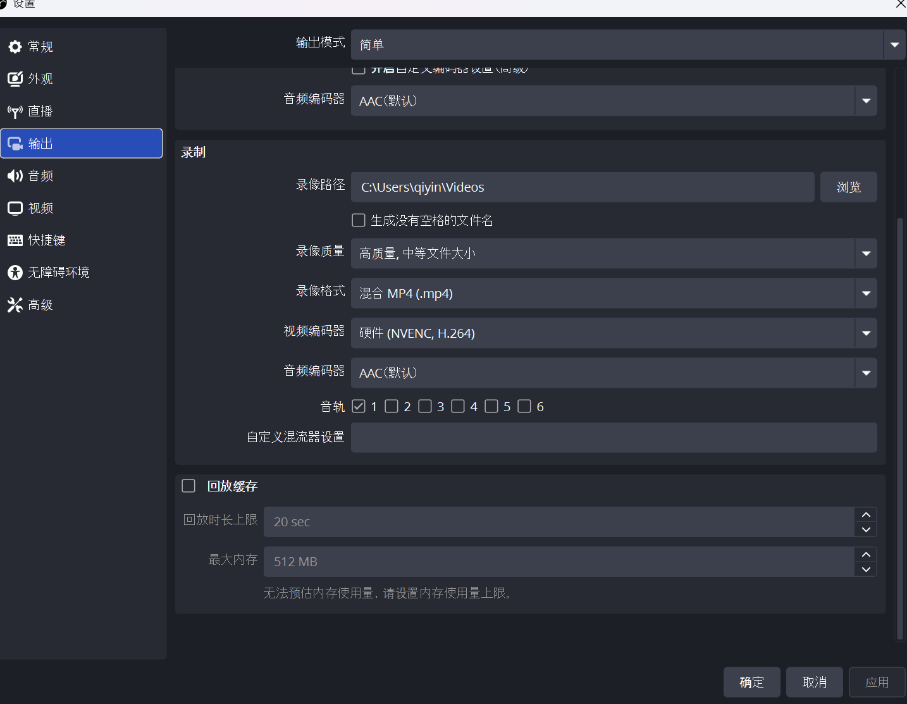
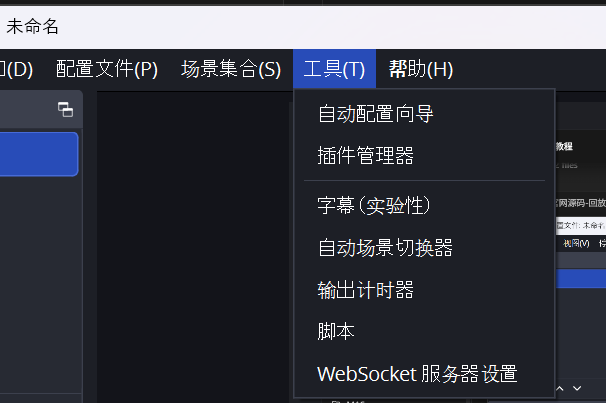
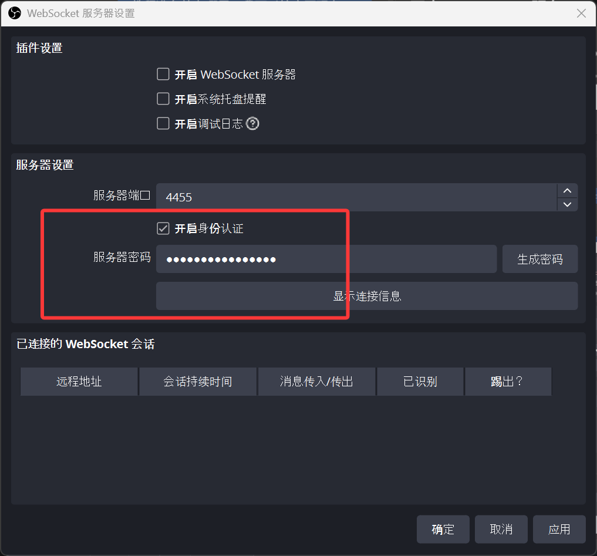

# 失败回放使用教程

自动代理失败时，AUTO-MAS 可以让 OBS 保存最近一段画面，并将视频与失败记录关联。遇到偶发卡住、登录失败或任务中断时，可以结合回放和日志查看失败前发生了什么。

配置顺序是：**让 OBS 捕获游戏画面 → 启动回放缓存 → 在 MAS 中配置连接 → 试存并检查视频**。配置完成后，保持 OBS 和回放缓存运行，MAS 会在自动代理最终失败时请求保存。

::: tip 版本要求
失败回放从 **v5.7.0-beta.2** 开始提供。若设置中没有这一项，请从[下载页](/download/auto-mas)获取包含该功能的版本。
:::

## 准备 OBS

在运行 AUTO-MAS 的**同一台电脑**上安装 [OBS Studio](https://obsproject.com/download)。建议使用 **OBS Studio 28 或更新版本**，这些版本已内置 MAS 使用的 WebSocket 功能，无需额外安装插件。参见 [OBS 官方远程控制指南](https://obsproject.com/kb/remote-control-guide)。

### 设置捕获画面

1. 打开 OBS，在“场景”中选择或新建一个场景。
2. 在“来源”下点击 **＋**，添加适合的画面来源，例如捕获模拟器的“窗口采集”，或捕获 PC 游戏的“游戏采集”。
3. 在来源属性中选择目标窗口，并确认 OBS 预览中能看到实际游戏画面。具体设置可参考 [OBS 窗口采集说明](https://obsproject.com/kb/window-capture-sources)和[游戏采集指南](https://obsproject.com/kb/game-capture-setup-guide)。

MAS 保存的是 **OBS 当前场景捕获到的内容**。切换脚本、游戏或模拟器实例后，需要确认来源仍能捕获对应画面；MAS 不会自动切换 OBS 场景。

### 开启并启动回放缓存

1. 打开 OBS 的 **设置 → 输出**。
2. 初次配置可以选择“简单”输出模式，设置录像路径、录像质量和编码器，再勾选 **回放缓存**（部分版本显示“开启回放缓存”）。使用“高级”输出模式时，在“回放缓存”页配置。
3. 设置 **回放时长上限**。建议先使用 **5 分钟，即 300 秒**；需要保留更早的过程时，可根据电脑内存和编码设置增加至 10–30 分钟。时长和内存上限都会影响实际能保留的视频长度。
4. 点击“应用”并关闭设置，回到 OBS 主界面，点击 **启动回放缓存**。按钮变为 **关闭回放缓存**，才表示缓存已经运行。OBS 中的相关步骤也可参考[回放缓存教程](https://obsproject.com/forum/resources/how-to-setup-instant-replay-in-obs-studio.613/)。



图中“回放缓存”尚未勾选，时长仍为 20 秒。实际使用时请勾选，并按上面的建议将时长设为 300 秒或更长，再回到主界面启动缓存。录像路径和编码器请按自己的电脑配置。

::: info 回放缓存是什么
OBS 持续在内存中保留最近一段视频，收到保存请求后才将这一段写成文件。例如配置 5 分钟缓存，保存的是请求时刻之前最多约 5 分钟的内容；刚启动缓存时，可保存的时长会更短。

视频长度、清晰度和声音由 OBS 设置决定。MAS 不会录下某个账号的完整任务过程，也无法补录缓存启动前的画面。
:::

### 开启 WebSocket 服务

1. 在 OBS 中打开 **工具 → WebSocket 服务器设置**。部分版本将此项命名为“obs-websocket 设置”。

   

2. 勾选 **开启 WebSocket 服务器**（部分版本显示“启用 WebSocket 服务器”），端口可使用默认值 **4455**。
3. 保持 **开启身份认证**（部分版本显示“启用身份验证”），设置或查看服务器密码，供下一步填写到 MAS。
4. 点击“应用”或“确定”保存。



红框标出了身份认证和密码区域。图中顶部的“开启 WebSocket 服务器”尚未勾选，实际使用时也要勾选并保存；仅开启身份认证还不能连接。

MAS 只连接本机 OBS，不能填写其他电脑的地址。OBS 官方也建议保留密码认证，默认端口和认证说明见 [obs-websocket 使用说明](https://github.com/obsproject/obs-websocket/blob/master/README.md)。

## 配置 AUTO-MAS

打开 **设置 → 功能设置 → 失败回放**，按下面的说明填写。

| 配置项             | 填写方法                                                         |
| ------------------ | ---------------------------------------------------------------- |
| 启用失败回放       | 设为 **是**，默认是 **否**。界面使用开关的版本，将开关打开即可。 |
| OBS WebSocket 端口 | 默认 **4455**，必须与 OBS 的服务器端口一致。                     |
| 最多保留数量       | 默认 **3 份**，可设置 **1–20 份**，限制的是 MAS 管理的视频副本。 |
| OBS WebSocket 密码 | 填写 OBS 的服务器密码，再点击 **保存密码**。                     |

密码保存后，输入框会重新变为空，并显示 **密码已配置**。留空离开不会删除已有密码；需要移除时，使用 **清空密码**。如果 OBS 启用了身份验证，清空 MAS 密码后将无法通过认证。

### 检查连接

点击 **检查连接**。正常时会显示 **OBS 已连接，回放缓冲已启动**，并列出：

- **连接状态：是**。
- **回放缓冲：已启动**。
- OBS 版本和 MAS 的回放目录。

“检查连接”只查询状态。即使连接成功，也需要确认回放缓冲是“已启动”；MAS 不会替你启动 OBS 或开启缓存。

### 试存一份视频

1. 保持 OBS 回放缓存运行，让游戏画面活动一会儿。
2. 在 MAS 中点击 **试存回放**，等待提示 **回放已保存**。
3. 打开 **历史记录 → 失败回放**，找到标记为 **手动测试 / 试存回放** 的条目，点击 **播放**。
4. 确认视频中有目标游戏画面，时长和声音符合需要。

::: warning 试存也会占用保留名额
试存会真实保存一份视频，与自动失败回放共用保留数量。连续试存可能使较旧的失败副本被清理；需要长期保留的视频，请先复制到其他目录。
:::

## 自动代理时如何保存

开始代理前，确认 OBS 已打开、目标画面可见、回放缓存已启动。之后照常运行 **自动代理** 或以自动代理模式运行调度队列即可。

| 运行结果                       | 是否自动保存                                     |
| ------------------------------ | ------------------------------------------------ |
| 账号重试后仍然失败             | 保存；同一脚本同一轮中，同一账号最多一份。       |
| 预检、启动或调度阶段失败       | 可以保存脚本级回放，可能没有对应账号的历史关联。 |
| 本次尝试失败，重试后成功       | 不保存。                                         |
| 成功、跳过、人工排查等其他模式 | 不自动保存。                                     |
| 手动停止或取消                 | 不再触发新回放；此前已发起的保存可能继续完成。   |

发现最终失败时，MAS 会请求 OBS 保存当时的回放缓存，再复制视频。文件写入和复制需要时间，列表可能稍后才出现新条目；有些失败是在超时或重试结束后才判定，想查看更早的过程需要增加 OBS 缓存时长。

如果 OBS 未运行、连接失败或保存出错，MAS 会提示 **失败回放未保存**。回放保存失败不会改变原来的代理结果。

## 查看失败回放

### 查看全部保留视频

打开 **历史记录**，点击页面右上角的 **失败回放**。

列表显示脚本、账号（有账号关联时）、时间、失败原因和视频路径。每条记录都可以：

- 点击 **播放**，使用系统默认视频播放器打开视频。
- 点击 **定位**，在文件资源管理器中选中视频文件。
- 点击列表顶部的 **打开回放目录**，查看 MAS 保存的副本。

MAS 使用系统默认程序播放视频。如果无法打开，可以通过“定位”找到文件，再使用支持该视频格式的播放器打开。

### 从任务日志查看关联视频

在历史记录中选择对应日期和账号，再打开失败任务的日志。如果这条日志有仍然保留的回放，日志窗口顶部会出现 **关联回放 N 份** 按钮；点击后可以播放或定位对应视频。

手动试存、没有账号历史的失败，或已经被清理的视频，可能没有这个按钮。找不到关联按钮时，先到 **历史记录 → 失败回放** 查看总列表。

## 视频存放与清理

视频会保存在两个地方：

| 位置                                 | 用途与清理规则                                                       |
| ------------------------------------ | -------------------------------------------------------------------- |
| OBS 设置的录像路径                   | OBS 保存的原始视频。**MAS 不会删除这些文件**，需要自行管理。         |
| AUTO-MAS 运行目录下的 `data/replays` | MAS 管理的副本。保存新视频后，超过“最多保留数量”的旧副本会自动清理。 |

这是按**份数**保留，不是按天数保留。调低数量后，要等下一次成功保存才会清理。常规配置备份不包含这些视频，需要长期保留时请另行复制。

即使 MAS 只保留 3 份，OBS 原始目录中的视频仍可能不断增加。清理 MAS 副本也不会释放 OBS 原文件占用的空间。

::: tip 失败后先等视频保存完成
退出、重启或关机时，MAS 只会有限等待正在保存的回放。需要保留这次失败画面时，建议等视频出现在列表中并确认能播放，再退出软件或关闭 OBS。
:::

## 让 OBS 启动时自动开启缓存

如果每天都使用失败回放，可以为 OBS 快捷方式添加启动参数，减少忘记启动缓存的情况。

1. 右键 OBS 快捷方式，打开 **属性 → 快捷方式**。
2. 在“目标”中保留原有程序路径，在末尾加一个空格，再加上 `--startreplaybuffer`。例如：

   ```text
   "C:\Program Files\obs-studio\bin\64bit\obs64.exe" --startreplaybuffer
   ```

3. “起始位置”应是 `obs64.exe` 所在目录。示例路径仅供参考，请使用自己的安装位置。
4. 保存后，通过这个快捷方式启动 OBS，再到 MAS 中“检查连接”，确认缓存已启动。

如需开机自动启动，可将这个快捷方式放进 Windows 的启动文件夹（按 **Win + R**，输入 `shell:startup`）。OBS 的启动参数用法见[官方说明](https://obsproject.com/kb/launch-parameters)。

## 常见问题

| 现象                         | 检查方法                                                                                                |
| ---------------------------- | ------------------------------------------------------------------------------------------------------- |
| 检查连接失败                 | 确认 OBS 正在同一台电脑上运行，WebSocket 服务已启用，两边端口一致；认证失败时重新填写并保存密码。       |
| 已连接，但回放缓冲未启动     | 回到 OBS，点击“启动回放缓存”。只在输出设置里勾选“开启回放缓存”还不够。                                  |
| 能保存，但视频黑屏或录错窗口 | 检查 OBS 预览、场景和捕获来源。连接检查通过只说明能连接，不能验证游戏画面。                             |
| 视频比设置的时长短           | 缓存可能刚启动，或受到 OBS 内存上限影响；先让缓存运行足够长，再试存检查。                               |
| 任务失败，却没有回放         | 确认使用自动代理模式、已启用功能且 OBS 缓存持续运行；查看任务是否出现“失败回放未保存”提示，并尝试试存。 |
| 历史日志没有“关联回放”       | 先查看总列表；这次失败可能没有账号历史关联，视频也可能已被清理或移走。                                  |
| 旧视频消失了                 | 新视频和试存共用保留名额。查看 OBS 原始目录，或提高 MAS 的保留数量，并及时另存重要片段。                |

反馈问题时，先播放视频确认内容，再提供**相关失败视频和同一次运行的日志**。如果捕获来源包含桌面或登录界面，分享前请检查其中是否有账号信息或其他不打算公开的内容。
