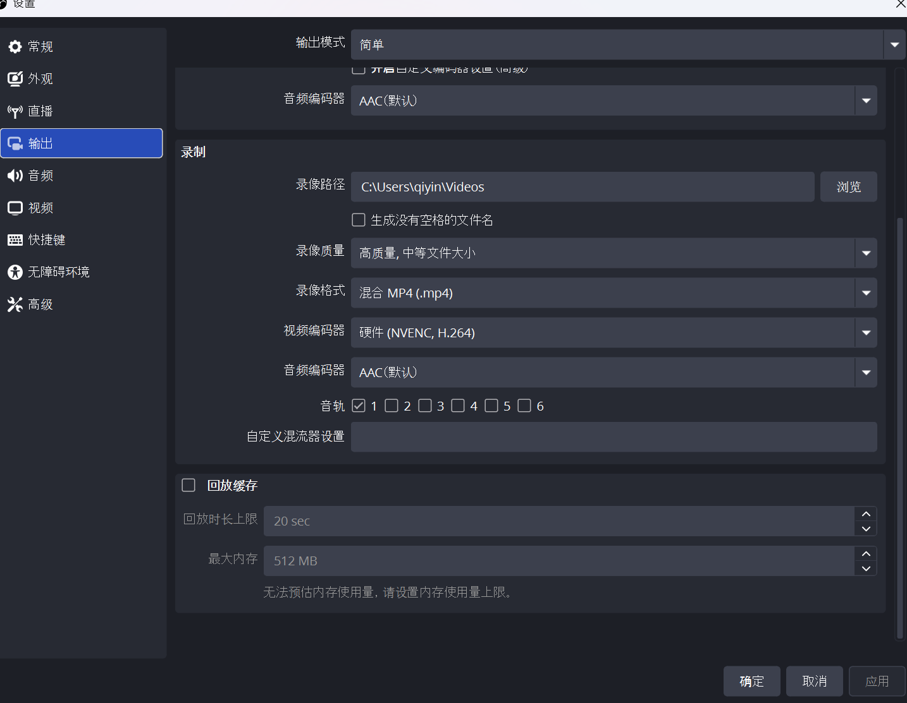
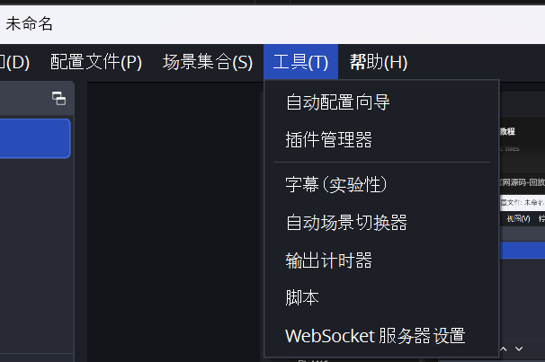
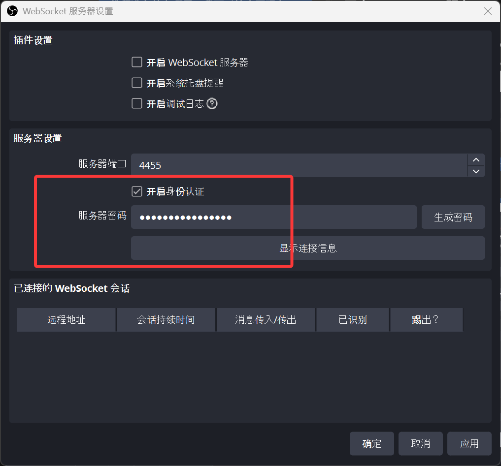

# 失败回放使用教程

自动代理失败时，AUTO-MAS 可以让 OBS 保存最近一段画面，并将视频与失败记录关联。遇到偶发卡住、登录失败或任务中断时，可以结合回放和日志查看失败前发生了什么。

配置顺序是：**让 OBS 捕获游戏画面 → 启动回放缓存 → 在 MAS 中配置连接 → 试存并检查视频**。配置完成后，保持 OBS 和回放缓存运行，MAS 会在自动代理最终失败时请求保存。

::: tip 版本要求
失败回放从 **v5.7.0-beta.2** 开始提供。若设置中没有这一项，请从[下载页](/download/auto-mas)获取包含该功能的版本。
:::

## 准备 OBS

在运行 AUTO-MAS 的**同一台电脑**上安装 [OBS Studio](https://obsproject.com/download)。建议使用 **OBS Studio 28 或更新版本**，这些版本已内置 MAS 使用的 WebSocket 功能，无需额外安装插件。参见 [OBS 官方远程控制指南](https://obsproject.com/kb/remote-control-guide)。

### 设置捕获画面

1. 打开 OBS，在“场景”中选择或新建一个场景。
2. 在“来源”下点击 **＋**，添加适合的画面来源，例如捕获模拟器的“窗口采集”，或捕获 PC 游戏的“游戏采集”。
3. 在来源属性中选择目标窗口，并确认 OBS 预览中能看到实际游戏画面。具体设置可参考 [OBS 窗口采集说明](https://obsproject.com/kb/window-capture-sources)和[游戏采集指南](https://obsproject.com/kb/game-capture-setup-guide)。

MAS 保存的是 **OBS 当前场景捕获到的内容**。切换脚本、游戏或模拟器实例后，需要确认来源仍能捕获对应画面；MAS 不会自动切换 OBS 场景。

### 开启并启动回放缓存

1. 打开 OBS 的 **设置 → 输出**。
2. 初次配置可以选择“简单”输出模式，设置录像路径、录像质量和编码器，再勾选 **回放缓存**（部分版本显示“开启回放缓存”）。使用“高级”输出模式时，在“回放缓存”页配置。
3. 设置 **回放时长上限**。建议先使用 **5 分钟，即 300 秒**；需要保留更早的过程时，可根据电脑内存和编码设置增加至 10–30 分钟。时长和内存上限都会影响实际能保留的视频长度。
4. 点击“应用”并关闭设置，回到 OBS 主界面，点击 **启动回放缓存**。按钮变为 **关闭回放缓存**，才表示缓存已经运行。OBS 中的相关步骤也可参考[回放缓存教程](https://obsproject.com/forum/resources/how-to-setup-instant-replay-in-obs-studio.613/)。



图中“回放缓存”尚未勾选，时长仍为 20 秒。实际使用时请勾选，并按上面的建议将时长设为 300 秒或更长，再回到主界面启动缓存。录像路径和编码器请按自己的电脑配置。

::: info 回放缓存是什么
OBS 持续在内存中保留最近一段视频，收到保存请求后才将这一段写成文件。例如配置 5 分钟缓存，保存的是请求时刻之前最多约 5 分钟的内容；刚启动缓存时，可保存的时长会更短。

视频长度、清晰度和声音由 OBS 设置决定。MAS 不会录下某个账号的完整任务过程，也无法补录缓存启动前的画面。
:::

### 开启 WebSocket 服务

1. 在 OBS 中打开 **工具 → WebSocket 服务器设置**。部分版本将此项命名为“obs-websocket 设置”。

   

2. 勾选 **开启 WebSocket 服务器**（部分版本显示“启用 WebSocket 服务器”），端口可使用默认值 **4455**。
3. 保持 **开启身份认证**（部分版本显示“启用身份验证”），设置或查看服务器密码，供下一步填写到 MAS。
4. 点击“应用”或“确定”保存。



红框标出了身份认证和密码区域。图中顶部的“开启 WebSocket 服务器”尚未勾选，实际使用时也要勾选并保存；仅开启身份认证还不能连接。

MAS 只连接本机 OBS，不能填写其他电脑的地址。OBS 官方也建议保留密码认证，默认端口和认证说明见 [obs-websocket 使用说明](https://github.com/obsproject/obs-websocket/blob/master/README.md)。

## 配置 AUTO-MAS

在左侧导航打开 **设置**，选择页面顶部的 **功能设置** 页签，再向下找到 **失败回放** 分组，按下面的说明填写。以下 MAS 操作与存储规则按 **v5.8.0-beta.3 后续 dev（3c9448bdf）** 核对；旧版的独立回放列表和按份数保留方式不适用于当前界面。

1. 准备好 OBS 后，打开 **启用失败回放**，对应图中①。
2. 核对 **OBS WebSocket 端口**，必须与本机 OBS 一致，对应②。
3. OBS 开启身份认证时，在 **OBS WebSocket 密码** 中填写密码，再点击 **保存密码**，对应③。

[](/docs/img/tutorial-context-20261105-3c9448bdf/failure-replay-settings.png)

本例不连接 OBS；密码输入和保存按钮仅作位置示意，未保存密码，也未检查连接、试存或播放回放。视频容量默认为 **1024 MiB**，按下表单独设置。

| 配置项 | 填写方法 |
| --- | --- |
| 启用失败回放 | 打开开关，默认关闭。 |
| OBS WebSocket 端口 | 默认 **4455**，必须与 OBS 的服务器端口一致。 |
| 视频容量上限（MiB） | 默认 **1024 MiB**，可设置 **1–1048576 MiB**，修改后点击 **保存容量**。所有历史视频共用此容量。 |
| OBS WebSocket 密码 | 填写 OBS 的服务器密码，再点击 **保存密码**。 |

密码保存后，输入框会重新变为空，并显示 **密码已配置**。留空离开不会删除已有密码；需要移除时，使用 **清空密码**。如果 OBS 启用了身份验证，清空 MAS 密码后将无法通过认证。

::: warning 降低容量会立即清理
点击 **保存容量** 后，超额的历史视频会按归档顺序从旧到新回收，日志和统计保留。需要长期保留的视频请先下载或复制到其他目录。仅修改输入框、尚未保存时不会清理。
:::

### 检查连接

点击 **检查连接**。正常时会显示 **OBS 已连接，回放缓冲已启动**，并列出连接状态、回放缓冲状态、OBS 版本，以及 OBS 已有回放的目录（如果能查询到）。

“检查连接”只查询状态。即使连接成功，也需要确认回放缓冲是“已启动”；MAS 不会替你启动 OBS 或开启缓存。

### 试存一份视频

1. 保持 OBS 回放缓存运行，让游戏画面活动一会儿。
2. 在 MAS 中点击 **试存回放**，等待 **OBS 试存成功，不创建历史记录**。
3. 按页面显示的 **试存文件位置（由 OBS 管理）**，在文件资源管理器中找到视频并播放。
4. 确认视频中有目标游戏画面，时长和声音符合需要。

试存会真实生成 OBS 原文件，**不会创建历史记录或 MAS 视频副本，也不占用历史视频容量**。试存文件需在 OBS 输出目录自行管理。

## 自动代理时如何保存

开始代理前，确认 OBS 已打开、目标画面可见、回放缓存已启动。之后照常运行 **自动代理** 或以自动代理模式运行调度队列即可。

| 运行结果 | 视频保存方式 |
| --- | --- |
| 账号重试后仍然失败 | 为该次失败历史保存视频附件；同一托管同一轮中，同一账号最多一份。 |
| 预检、启动或调度阶段失败，没有对应账号历史 | 可请求 OBS 保存诊断原文件，路径显示在任务提示或日志中；不创建独立历史回放。 |
| 本次尝试失败，重试后成功 | 不为成功结果保留失败视频附件。 |
| 成功、跳过、配置或更新等其他模式 | 不自动保存失败视频。 |
| 手动停止或取消 | 不为取消结果新增历史视频；已发出的请求可能已在 OBS 输出目录生成原文件。 |

发现最终失败时，MAS 会请求 OBS 保存当时的回放缓存，再将视频随账号执行记录归档。文件写入和复制需要时间；有些失败是在超时或重试结束后才判定，想查看更早的过程需要增加 OBS 缓存时长。

如果 OBS 未运行、连接失败或保存出错，任务提示和日志会说明回放未采集或未保存。回放失败不会改变原来的代理结果。

## 查看失败回放

1. 打开 **历史记录**，选择对应日期和账号。
2. 打开失败的执行记录，在日志窗口展开 **附件（N）**。
3. 视频可在窗口内播放，也可点击附件旁的 **下载**，另存后用支持该格式的播放器打开。

当前版本没有独立的“失败回放”总列表或“关联回放”按钮。试存和无账号归属的诊断回放只在 OBS 输出目录；它们不出现在历史附件中。

若附件提示 **视频未保存或已因容量上限回收**，请检查容量设置与 OBS 原始目录。文件丢失、归档目录不可用或归档失败也会显示对应提示，日志和统计仍可查看。

## 视频存放与清理

| 位置 | 用途与清理规则 |
| --- | --- |
| OBS 设置的录像路径 | OBS 保存的原始视频，包括试存和诊断回放。**MAS 不会删除这些文件**，需要自行管理。 |
| AUTO-MAS 运行目录下的 `history/日期/记录编号/` | 与执行记录一起保存的日志和视频附件。超出历史视频容量时，从最早归档的视频开始回收；记录本身仍按历史保留期限清理。 |

视频按**总容量**管理，不按份数保留。单个视频大于容量上限时也可能无法归档；降低容量后点击保存会立即清理。容量回收只移除视频，不移除同一记录的日志和统计；历史记录超过保留期限时，其附件也会随记录删除。

**导出数据备份包含当时仍可用的历史附件**，但不包含 OBS 原始目录中的文件。备份可能含游戏画面与账号信息，请妥善保管；需要分享某次失败时，优先下载对应视频并附上同次日志。

即使 MAS 已回收副本，OBS 原始目录中的视频仍可能不断增加。清理 MAS 副本不会释放 OBS 原文件占用的空间。

::: tip 失败后先等视频保存完成
退出、重启或关机时，MAS 只会有限等待正在保存的回放。需要保留这次失败画面时，建议等执行记录的附件可播放后，再退出软件或关闭 OBS。
:::

## 让 OBS 启动时自动开启缓存

如果每天都使用失败回放，可以为 OBS 快捷方式添加启动参数，减少忘记启动缓存的情况。

1. 右键 OBS 快捷方式，打开 **属性 → 快捷方式**。
2. 在“目标”中保留原有程序路径，在末尾加一个空格，再加上 `--startreplaybuffer`。例如：

   ```text
   "C:\Program Files\obs-studio\bin\64bit\obs64.exe" --startreplaybuffer
   ```

3. “起始位置”应是 `obs64.exe` 所在目录。示例路径仅供参考，请使用自己的安装位置。
4. 保存后，通过这个快捷方式启动 OBS，再到 MAS 中“检查连接”，确认缓存已启动。

如需开机自动启动，可将这个快捷方式放进 Windows 的启动文件夹（按 **Win + R**，输入 `shell:startup`）。OBS 的启动参数用法见[官方说明](https://obsproject.com/kb/launch-parameters)。

## 常见问题

| 现象                         | 检查方法                                                                                                |
| ---------------------------- | ------------------------------------------------------------------------------------------------------- |
| 检查连接失败                 | 确认 OBS 正在同一台电脑上运行，WebSocket 服务已启用，两边端口一致；认证失败时重新填写并保存密码。       |
| 已连接，但回放缓冲未启动     | 回到 OBS，点击“启动回放缓存”。只在输出设置里勾选“开启回放缓存”还不够。                                  |
| 能保存，但视频黑屏或录错窗口 | 检查 OBS 预览、场景和捕获来源。连接检查通过只说明能连接，不能验证游戏画面。                             |
| 视频比设置的时长短           | 缓存可能刚启动，或受到 OBS 内存上限影响；先让缓存运行足够长，再试存检查。                               |
| 任务失败，却没有回放         | 确认使用自动代理模式、已启用功能且 OBS 缓存持续运行；查看任务是否出现“失败回放未保存”提示，并尝试试存。 |
| 执行日志没有视频附件 | 确认是否为有历史记录的账号失败；试存与无账号归属的诊断视频只在 OBS 输出目录。 |
| 旧视频消失了 | 检查历史视频容量与历史保留期限，查看 OBS 原始目录；需要时提高容量，并及时另存重要片段。 |

反馈问题时，先播放视频确认内容，再提供**相关失败视频和同一次运行的日志**。如果捕获来源包含桌面或登录界面，分享前请检查其中是否有账号信息或其他不打算公开的内容。
